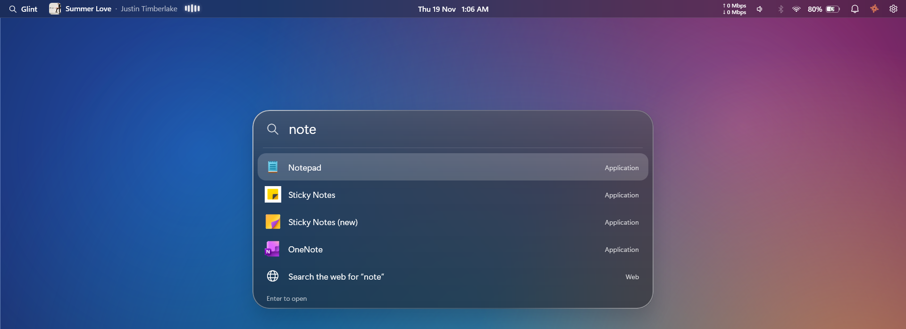
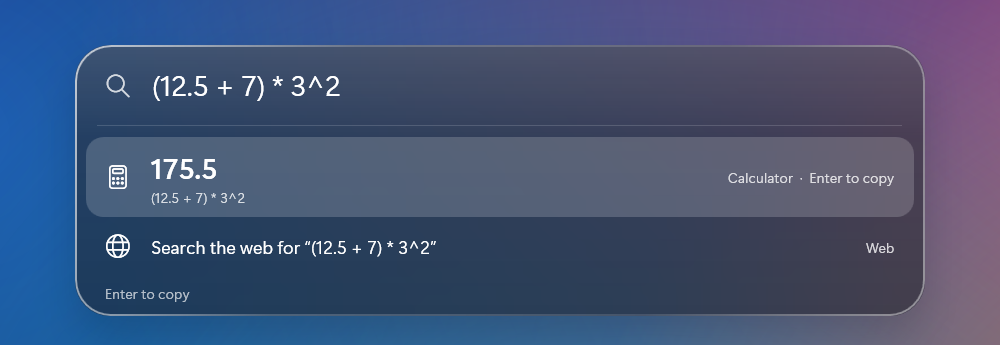
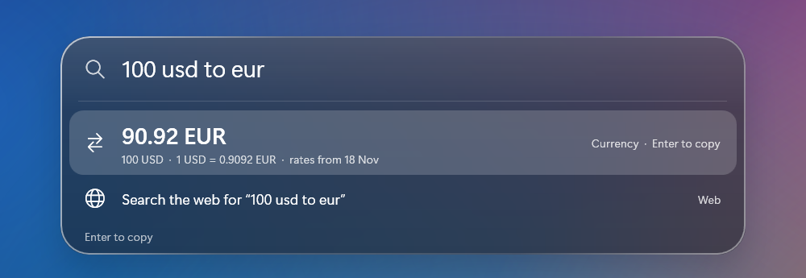
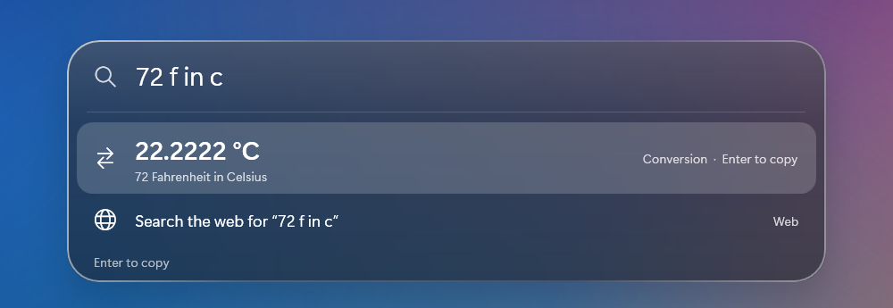
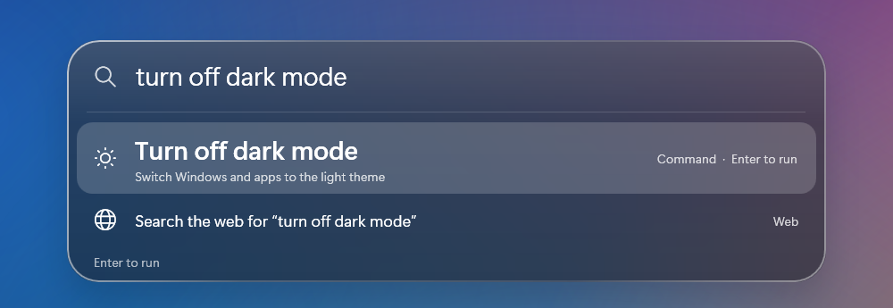
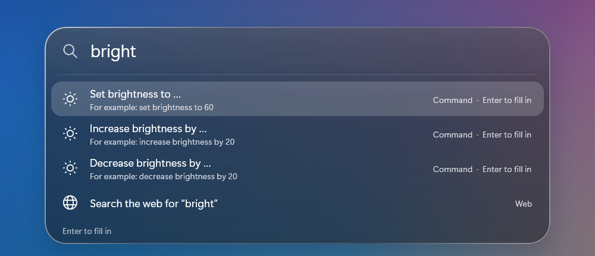
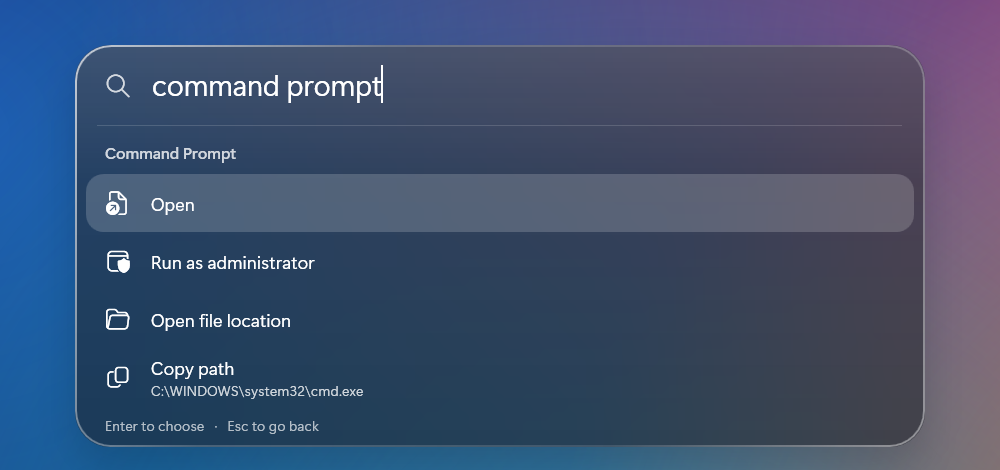
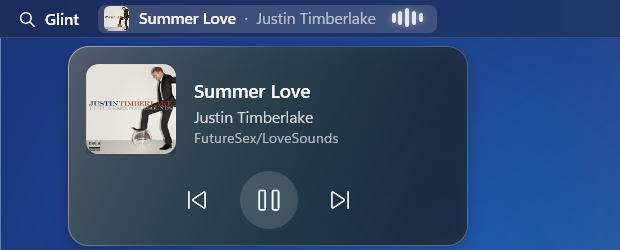
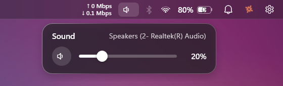
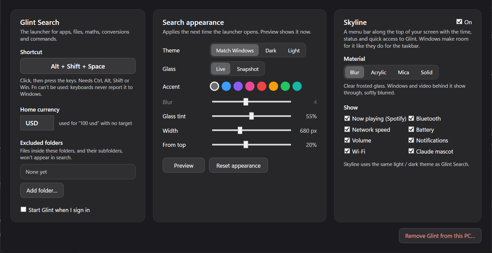

# Glint

A fast, glassy launcher and menu bar for Windows 11, inspired by Spotlight on macOS.

- **Glint Search**: press a shortcut, type, hit Enter. Apps, files, maths, unit and currency conversions, and plain-English commands like *"turn off dark mode"* or *"open notepad and spotify"*.
- **Skyline**: a menu bar along the top of your screen with the time, what's playing on Spotify (with a live waveform), network speed, volume, Wi-Fi, Bluetooth, battery and notifications.



## Download

1. Go to **[Releases](../../releases)** and download `Glint-<version>-win-x64.zip`.
2. Unzip it and run **Glint.exe**. Nothing needs installing: Glint is a single, self-contained file.
3. The first time, Windows may show **"Windows protected your PC"**, because Glint isn't code-signed yet.
   Click **More info → Run anyway**.

Glint lives in the system tray. Put Glint.exe wherever you like to keep it (for example `C:\Apps\Glint`),
then turn on **Settings → Start Glint when I sign in** if you want it running all the time.

**Requirements:** 64-bit Windows 11. Windows 10 version 2004 or later should work, but isn't tested.

## Glint Search

Open it with **Ctrl + Alt + Space**. If that's taken on your PC, Glint picks the first free one of
Alt + Shift + Space, Ctrl + Shift + Space or Alt + Win + Space, and you can change it any time in Settings.

| Type | You get |
|---|---|
| `spot` | Apps, best match first. Apps you open often move up. |
| `report q3` | Files and folders, from Windows' own search index. |
| `> report` or `files report` | Only files and folders, with more of them. (`file` on its own still finds File Explorer.) |
| `chrome`, `budget.xlsx` | Open windows that match, to switch straight to them. |
| `:fire` or `emoji party` | Emoji, in colour. Enter copies one. |
| `(12.5 + 7) * 3^2`, `150 + 10%`, `sqrt(2)` | The answer. Enter copies it. |
| `5 km to mi`, `72 f in c`, `2 acres to perches` | Unit conversions (length, weight, volume, area, speed, time, data, temperature, energy, pressure, power). |
| `100 usd to lkr`, `€50` | Currency conversions with daily rates. |
| `turn off dark mode`, `volume 40`, `set brightness to 60` | Commands for the theme, volume, brightness, Wi-Fi, Bluetooth, media, timers and more. |
| `open notepad and spotify` | Opens several apps at once. |
| `shut down`, `restart` | Always asks you to confirm first. |

Partial commands show suggestions as you type (`set` → *Set volume to …*). On a file or app, press
**Tab** or **→** for more actions: Open with, Show in Explorer, Copy path, Run as administrator and so on.
You can exclude folders from file search in Settings.

Only want the menu bar? Turn off **Settings → Glint Search** (or untick it in the tray menu). Skyline keeps
running, and the shortcut is freed up for other apps.

| | |
|---|---|
|  |  |
|  |  |
|  |  |

## Skyline

A menu bar docked to the top of every monitor; maximised windows make room for it, just like the taskbar.
To keep it on your main monitor only, untick **Settings → Skyline → Show on every monitor**.


| | |
|---|---|
|  |  |

- **Left:** a Glint button, and what's playing on Spotify: cover, song and a waveform that follows the real
  bass, mids and treble of the music, tinted with the album's colour. Click it for playback controls.
- **Middle:** date and time. Click for the Windows calendar and notifications.
- **Right:** network speed (click for data used since your PC started), volume (click for the main slider and
  a slider for each app playing sound; click an app's icon to mute it; scroll to adjust), Bluetooth, Wi-Fi and battery (click for Quick Settings), notifications, the optional Claude
  mascot and Glint's settings.

Choose its material (Blur, Acrylic, Mica or Solid) and what it shows in **Settings → Skyline**, or turn it off.



## Claude mascot (optional)

If you use [Claude Code](https://claude.com/claude-code), Skyline can show a small mascot that spins while
Claude is working and flashes the bar orange when Claude is done or needs you. It's **off by default**.

Turning it on in Settings adds a few hooks to Claude Code's settings file (`~/.claude/settings.json`), after
asking you. They only tell Glint "busy" or "ready"; nothing you type is stored or sent anywhere. Your other
Claude Code settings and hooks are left as they are, a backup is saved first, and turning the mascot off
removes Glint's hooks again. It works with Claude Code (terminal, the desktop app's Code tab, editor
extensions), not with regular chats.

## Privacy

Glint has no accounts, no telemetry and no analytics.

- **Internet:** only to download exchange rates (from [ExchangeRate-API](https://www.exchangerate-api.com)),
  and when you choose *Search the web*, which opens your browser.
- **Spotify:** read from Windows' own media controls, so no Spotify login is needed.
- **Audio:** the waveform listens to what your speakers play, only while a song plays. It never uses the microphone.
- **Your data** stays on your PC, in `%AppData%\Glint`.

## Removing Glint

Open **Settings → Remove Glint from this PC**. That turns off start-at-sign-in, removes the Claude mascot's
hooks and deletes Glint's settings, then quits and shows you Glint.exe so you can delete it.

If you've already deleted Glint.exe:
1. Delete the folder `%AppData%\Glint`.
2. If Glint started with Windows, turn it off in **Task Manager → Startup apps**.
3. If you used the Claude mascot, remove the entries that run Glint.exe with `--glint-claude-hook` from
   `~/.claude/settings.json`.

## Building from source

You need the [.NET 9 SDK](https://dotnet.microsoft.com/download).

```bash
dotnet build -c Release
```

Then run `bin\Release\net9.0-windows\Glint.exe`.

### Making a release

```bash
dotnet publish -c Release -p:PublishProfile=GitHub
```

This makes a single self-contained `publish\Glint.exe` (about 170 MB, so it runs without .NET installed).
Zip it and attach the zip to a GitHub release (about 66 MB):

```powershell
Compress-Archive publish\Glint.exe publish\Glint-1.1.0-win-x64.zip
```

The exe is deliberately not compressed internally: compression makes it smaller but roughly triples Glint's
memory use and slows the Claude hooks, so the zip does the shrinking instead.

### Command line

| Command | Does |
|---|---|
| `Glint.exe --background` | Starts in the tray without opening the launcher. |
| `Glint.exe --query "text"` | Opens the launcher with text already typed. |
| `Glint.exe --quit` | Closes the running Glint cleanly. |
| `Glint.exe --claude-hooks install`, `remove` or `status` | Manages the Claude mascot's hooks. |

## Credits

Exchange rates by [ExchangeRate-API](https://www.exchangerate-api.com).

## License

[MIT](LICENSE) © 2026 The Glint Authors
